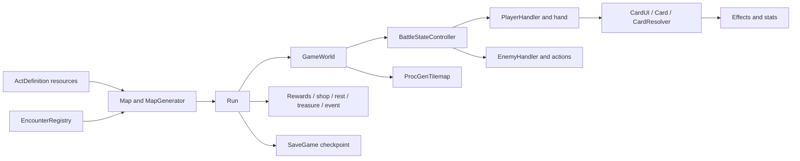

# Architecture and state ownership

The game has two nested loops. **Run** owns the route through rooms and persistent
player state. **GameWorld** owns one battle on a generated hex arena. A route node
stores an authored encounter definition; entering that node creates a GameWorld
using the run's player, economy and relic state. Victory returns control to Run
for rewards or an act transition.

| Owner | Responsibility and source |
| --- | --- |
| Run | `scenes/run/run.gd`: view replacement, room entry, rewards, act transitions, save/load and telemetry progression context. |
| Map | `scenes/map/map.gd` and `map_generator.gd`: connected routes, floor unlocking and encounter assignment. |
| EncounterDefinition | `scripts/resources/encounter_definition.gd`: content identity, tier/category, composition, arena settings and reward ranges. |
| EncounterRegistry | `scripts/resources/registry/encounter_registry.gd`: eligible weighted selection; no second encounter pool. |
| GameWorld | `scenes/game_world/game_world.gd`: battle setup, completion and board/handler/presentation coordination. |
| CardInteractionController | `scenes/game_world/card_interaction_controller.gd`: click/drag/aim ownership, cancellation, selector/tooltip context and live play authorization/resolution lock; injected into normal and spotlight draws through PlayerHand. |
| BattleStateController | `scenes/game_world/battle_state_controller.gd`: player/enemy phases, rounds, collapse and stable victory checks. |
| PlayerHandler | `scenes/player/player_handler.gd`: hand/draw/discard, turn status/relic sequencing and cancellation. |
| EnemyHandler | `scripts/nodes/enemy_handler.gd`: living enemy setup, serial actions, intent rail and turn cancellation. |
| SummonHandler | `scenes/construct/summon_handler.gd`: battle-local allied constructs, placement/relocation and awaited allied activations. Uses ProcGenTilemap occupancy. |
| ProcGenTilemap | `scripts/nodes/proc-gen-tilemap.gd`: authoritative cells, conversion, occupancy, fog, tile effects and collapse. |
| Presentation | `ui/world_ui/board_overlay.gd`, terrain depth, HUDs, effects and WorldCamera consume real board/combat state. |

`MapNode.battle_stats` holds an `EncounterDefinition`. EncounterRegistry owns
weighted selection; RegistryData exposes registry-based content lookup for
developer tools. This keeps the encounter definition and selection rules shared
between map generation, the sandbox and authoring tools.

## Shared resources and runtime state

Cards, relics, stats and encounters are authored Godot Resources. Loaded resources
may be shared through the engine cache. PlayerStats creates an instance for a new
run; battle startup isolates the selected encounter's mutable reward counters.
Do not mutate a loaded definition to accumulate selection weights or runtime state.
SaveGame explicitly reloads and deeply duplicates mutable save data while retaining
the saved graph's relationships. [Campaign](campaign.md) covers checkpoints.

CardUI and its states retain scene-authored drag/aim presentation and animations.
CardStateMachine routes transitions through CardInteractionController, which owns
one active gesture, motion/confirm/cancel decisions and sibling-card locking.
Phase changes return the active card to the hand before turn cleanup. Unavailable
hands, removed cards and world teardown release gesture/selector/tooltip state;
deferred reparenting cannot unlock a card outside a playable phase. Spotlight
cards acquire logical hand ownership before interaction is allowed.

The controller binds the battle's selector directly. Selector picking, visible
highlight cells and tooltip enemy modifiers use the same active-card context and
target predicate. Board/fog, enemy and player-stat changes invalidate previews;
an empty target set never grants unrestricted selection. Global drag/aim signals
are feedback notifications for camera, hints and inspection, not interaction
authority. A committed tile target survives cache invalidation until resolution
finishes, then is released. CardUI asks the battle-owned
CardInteractionController to authorize and lock each play before using Card's
normal cost/effect path. CardUI.can_execute delegates to the same live checks
for mouse release and AutoWalker; target previews never authorize a play. The
controller rejects stale phases/costs, invalid or foreign targets, and overlapping
resolution. Only the resolving card can release its lock. Accepted target arrays
are copied before asynchronous effects begin. Configured cards use CardResolver
and CardFxRunner; legacy custom cards can override effect hooks. Effects update Stats/ModifierHandler/StatusHandler rather
than a separate UI model. Async damage, movement and status completion matter:
awaiting a single card method is not always the whole action boundary.

Cross-system notifications use `scripts/autoloads/events.gd`. RNG owns seeded
gameplay randomness; policies have a separate stream and cosmetics must not
consume the gameplay stream. GameSettings owns player settings/telemetry consent.
TelemetryManager adapts gameplay events to the standalone addon; neither combat
nor progression requires the backend to be available.

Run and GameWorld compose their own HUD/tutorial scenes and bind dependencies
through public properties/signals. Shared UI styling lives in one project theme.
Phantom Camera owns production combat framing; avoid competing camera controllers.
Presentation children animate without moving occupancy/collision roots.

[AutoWalker internals](autowalker-internals.md) explains observation, legal-action
validation, replay checkpoints and cancellation. For new definitions, follow
[content authoring](content-authoring.md).

## Finding a card's behavior

Start with its `.tres` under `resources/data/cards/<pool>/`. Pulse Rifle is a
straight example: its resource declares one six-damage CardEffectConfig and uses
Card directly. Card pays/emits once, CardResolver selects the normal effect, and
DamageEffect applies the authoritative hit. No class-wide card-ID switch exists.
For a condition/tradeoff, its script sits beside the resource (for example
`riftwalker/cash_out.gd`). Ordinary movement reuses Phase Step; actual construct
placement belongs to ConstructSummonCard and SummonHandler. The historical
`synthforged_card.gd` path contains that summon behavior only, retained for saved
resource compatibility. Cosmetic scenes are explicit PackedScene references,
not paths synthesized from a card ID. See [content authoring](content-authoring.md)
and [the expansion inventory](card-pool-expansion.md).

## Hex geometry and sight queries

ProcGenTilemap owns cell geometry. The authored TileSet uses diamond-down axial
Vector2i coordinates, not staggered offset columns. `offset_to_cube` and
`cube_to_offset` retain historical names for compatibility: a cell (x, y) maps to
cube (x, y, -x-y). `hex_distance` accepts cubes; gameplay callers use
`cell_distance`. This matches all six TileMap neighbors, including negative cells.
Cube footprint offsets therefore translate consistently at every anchor.

`get_tiles_in_range` returns a geometric disk including its center;
`get_tiles_in_ring` returns exactly the boundary. Zero radius gives the center;
negative radius gives no cells. Both use deterministic cube-loop ordering and
can include absent terrain. Callers apply terrain, occupancy and fog rules.
Cards use the shared ring for adjacent targeting; constructs, bosses and AI
weights use shared cell distance. SummonHandler.distance remains a compatibility
wrapper. `get_surrounding_tiles_in_radius` intentionally retains its existing
bounded neighbor traversal: it cannot cross missing terrain, preserves traversal
order and can revisit the center for radius >= 2. Movement, spawn searches,
support and deployment callers retain that behavior instead of using a disk.

`has_line_of_sight(source, target)` implements current player sight: both cells
must exist and the destination must be persistently revealed. There is no ray
occlusion by terrain, corruption or actors, and intermediate fog is not a blocker.
Enemy visible footprints and card previews share this rule. Enemy AI remains
independent of player fog; range/path reachability and live card authorization
remain separate checks. Do not introduce ray blocking by replacing this contract.
