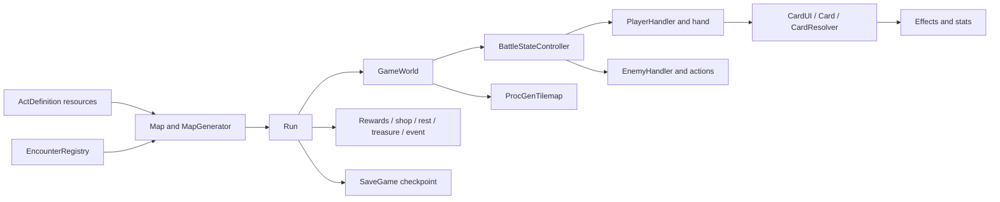

# Architecture and state ownership

The game has two nested loops. **Run** owns the route through rooms and persistent
player state. **GameWorld** owns one battle on a generated hex arena. A route node
stores an authored encounter definition; entering that node creates a GameWorld
using the run's player, economy and relic state. Victory returns control to Run
for rewards or an act transition.

| Owner | Responsibility and source |
| --- | --- |
| Run | `scenes/run/run.gd`: view replacement, room entry, rewards, act transitions, save/load and telemetry progression context. |
| Map | `scenes/map/map.gd` and `map_generator.gd`: connected routes, floor unlocking and encounter assignment. |
| EncounterDefinition | `scripts/resources/encounter_definition.gd`: content identity, tier/category, composition, arena settings and reward ranges. |
| EncounterRegistry | `scripts/resources/registry/encounter_registry.gd`: eligible weighted selection; no second encounter pool. |
| GameWorld | `scenes/game_world/game_world.gd`: battle setup, completion and board/handler/presentation coordination. |
| BattleStateController | `scenes/game_world/battle_state_controller.gd`: player/enemy phases, rounds, collapse and stable victory checks. |
| PlayerHandler | `scenes/player/player_handler.gd`: hand/draw/discard, turn status/relic sequencing and cancellation. |
| EnemyHandler | `scripts/nodes/enemy_handler.gd`: living enemy setup, serial actions, intent rail and turn cancellation. |
| ProcGenTilemap | `scripts/nodes/proc-gen-tilemap.gd`: authoritative cells, conversion, occupancy, fog, tile effects and collapse. |
| Presentation | `ui/world_ui/board_overlay.gd`, terrain depth, HUDs, effects and WorldCamera consume real board/combat state. |

`MapNode.battle_stats` holds an `EncounterDefinition`. EncounterRegistry owns
weighted selection; RegistryData exposes registry-based content lookup for
developer tools. This keeps the encounter definition and selection rules shared
between map generation, the sandbox and authoring tools.

## Shared resources and runtime state

Cards, relics, stats and encounters are authored Godot Resources. Loaded resources
may be shared through the engine cache. PlayerStats creates an instance for a new
run; battle startup isolates the selected encounter's mutable reward counters.
Do not mutate a loaded definition to accumulate selection weights or runtime state.
SaveGame explicitly reloads and deeply duplicates mutable save data while retaining
the saved graph's relationships. [Campaign](campaign.md) covers checkpoints.

CardUI handles interaction and commits a play through Card's normal cost/effect
path. Configured cards use CardResolver and CardFxRunner; legacy custom cards can
override effect hooks. Effects update Stats/ModifierHandler/StatusHandler rather
than a separate UI model. Async damage, movement and status completion matter:
awaiting a single card method is not always the whole action boundary.

Cross-system notifications use `scripts/autoloads/events.gd`. RNG owns seeded
gameplay randomness; policies have a separate stream and cosmetics must not
consume the gameplay stream. GameSettings owns player settings/telemetry consent.
TelemetryManager adapts gameplay events to the standalone addon; neither combat
nor progression requires the backend to be available.

Run and GameWorld compose their own HUD/tutorial scenes and bind dependencies
through public properties/signals. Shared UI styling lives in one project theme.
Phantom Camera owns production combat framing; avoid competing camera controllers.
Presentation children animate without moving occupancy/collision roots.

[AutoWalker internals](autowalker-internals.md) explains observation, legal-action
validation, replay checkpoints and cancellation. For new definitions, follow
[content authoring](content-authoring.md).
