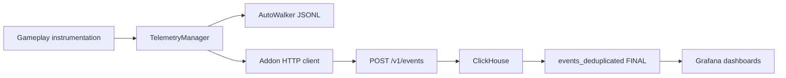

# Telemetry architecture and operation

Telemetry connects gameplay observations to local QA evidence and optional
analytics. Gameplay calls TelemetryManager; the standalone Godot addon validates
and queues events; HTTP ingestion stores accepted batches in ClickHouse; Grafana
queries a deduplicated view. Neither combat nor local AutoWalker reports requires
a reachable backend.



## Configuration, consent and collection

The game adapter is `scripts/autoloads/telemetry_manager.gd`; reusable client,
configuration and transports live in `addons/godot_telemetry/`. See the
[addon API/transport reference](../addons/godot_telemetry/README.md) for configuration
fields, supported schema subset, batching, retries, purge and integration examples.
The addon contains no game event names or database assumptions.

`telemetry/config/production.tres` currently enables HTTP at
`http://docker01.voidmoose.local:8080/v1/events`. This endpoint is for LAN development. The default Resource
values supply the environment/profile/consent behavior; the filename does not
by itself make the environment production. Select another authored configuration
through the `ProjectSettings["telemetry/config_path"]` setting. The `--validation-local` game argument overrides
it with `scripts/tests/telemetry_null.tres`. Use HTTPS for an external production
endpoint; exported client Resources must never contain server credentials.

GameSettings.telemetry_enabled controls player consent. Queue acceptance is not
delivery. Opt-out clears local queues/files and cancels pending HTTP, but cannot
recall a batch already accepted remotely. HTTP retries are bounded in memory,
not a crash-durable disk spool. JSONL is bounded offline collection, not an upload
queue. Shutdown allows a bounded 15-second drain rather than blocking indefinitely.

AutoWalker reconfigures the primary client for fresh per-launch JSONL under its
output directory, with `environment=qa`, `profile=qa` and `source_type=bot`.
A second client can use the enabled configured HTTP transport. Both share run/session
context but generate destination-specific event IDs; retries preserve their IDs.
The Python launcher uses fresh disposable saves whose consent defaults off.
Use `--telemetry-upload` to opt this launch into uploads; use `--telemetry-local`
for explicit offline operation. They are mutually exclusive. Direct editor Watch
uses the editor project's settings. See [AutoWalker](autowalker.md) for storage
limits and telemetry health fields.

Production profiles suppress diagnostic schemas such as detailed enemy, turn,
simulation-action and console diagnostics. The QA profile retains diagnostic
coverage. Event instrumentation covers session/run/floor, room/reward/purchase,
card and combat activity, encounter outcomes, enemy lifecycle/fallback, Obelisk
destruction, collapse and simulation actions/results. Exact names, versions,
required properties and diagnostic flags are in `telemetry/schemas/events.json`.
Do not infer event availability merely from a dashboard title.

## Identity, metrics and instrumentation changes

The event envelope carries event ID/name/version, UTC timestamp, game/environment,
build, session/run, source type, metadata and properties. IDs are random, not host
identifiers; human/bot labels are client-provided attribution, not trusted identity.
Numeric metrics remain numbers where callers supply numbers; some legacy
properties still use strings.

RunStats persists run identity across checkpoints. Before room entry Run binds
`act_id`, one-based act, act_floor, cumulative run_floor, encounter ID/category
into metadata. Session events can have empty run IDs. `act_started`, `act_completed`,
`run_failed` and `card_removed` are adapter lifecycle markers recorded as
`stat_changed` with `metadata.lifecycle_event`; do not query them as standalone
event_name values. Explicit per-event metadata merges over progression context.
Metadata is bounded to 4096 UTF-8 bytes.

`encounter_completed` and `simulation_completed` v2 separate actual health damage
(post-block and clamped to remaining HP), effective healing and net health loss.
Simulation turns span all battles; last battle turn and floors are separate.
V1 damage was net health loss and run turns described only the last battle.
Keep schema/metrics versions separate in analysis and matched comparisons.
Completion metadata includes reason/code, policy identity, action counts, limits,
final health, last action and diagnostic counts. Older events may lack those keys.

To add/change instrumentation:

1. Find the authoritative boundary (committed card cost, actual health removal,
   room selection, stable victory), not an animation or preview callback.
2. Check the deployed contract. The backend submodule bundles its own schema;
   support a new event/version there first and deploy ingestion support before
   the game emits it. Preserve old versions needed by shipped clients.
3. Update the game's `telemetry/schemas/events.json`, caller and relevant checks.
   Use versioning for incompatible required-property/type changes. Bounded
   metadata can carry compatible attribution; it is not a second metrics schema.
4. Validate offline and verify live acceptance/deduplicated rows separately when
   operator access and deployment are in scope. A source schema match alone
   does not prove the running host has it.

The deployed-schema-compatible campaign markers require no new table migration.
The same applies to v2 metrics when the backend already supports those versions.

## Backend operation

The independent backend is pinned as `backend/telemetry` in `.gitmodules`.
Its [operator README](../backend/telemetry/README.md) owns exact deployment,
authentication repair, retention, backup and rollback procedures. Run its commands
from **that directory or a standalone backend checkout**, not the game root.
This guide connects those procedures to game evidence instead of copying them.

Compose defines ClickHouse, Python ingestion and Grafana. API/Grafana expose host
ports 8080/3000; ClickHouse stays on the internal analytics network. Ingestion uses
ClickHouse HTTP internally; Grafana provisioning uses Native port 9000 with a
read-only grafana_reader account. Four independent passwords come from an ignored
`.env`; configuration-managed users/grants load at ClickHouse startup. Backend
image builds are independent of the game and bundle their own schema JSON.

For a host already configured with `.env`, the backend's source-prescribed update
commands are:

```sh
# From the backend checkout, on the operator's Docker host:
docker compose up -d --build ingest
docker compose restart grafana
```

These mutate the deployment; they are not documentation validation commands.
New ClickHouse volumes run init migrations; existing volumes require explicit
application of new migrations. Do not delete volumes to fix authentication.
A dashboard-only change needs the updated provisioned JSON files and Grafana
restart, without ingestion rebuild or database migration. Dashboard MCP saves
require write permission and may be superseded by file provisioning.

The API accepts `POST /v1/events` with `{ "events": [envelope, ...] }`, 1–100 events,
up to 1 MiB per request and 16 KiB per event. Unknown/malformed contracts reject
the whole batch. A 200 response must acknowledge the submitted count; 429/503
are retryable. `/health` is process liveness, not proof of storage readiness.
Check a known accepted batch and its deduplicated rows before declaring delivery
healthy. A public deployment additionally needs the backend README's proxy/TLS,
body/deadline/rate restrictions and private database/metrics access.

ReplacingMergeTree retries deduplicate by game/event ID. Queries use
`telemetry.events_deduplicated` (FINAL) for immediate deduplicated semantics.
The event table TTL is 90 days, ingestion health 30 days; physical expiry is
eventual. Timestamps outside the seven-day acceptance window are rejected, so
old JSONL is not automatically replayable into ingestion. Backups/restore and
rollback must be planned separately from retention.

## Query gameplay and QA evidence

Grafana provisions Gameplay Overview, Combat Balance, Enemy AI, AutoWalker QA and
Telemetry Health. Filter game, environment, build, source and time deliberately.
Human dashboards default to human; AutoWalker data is QA/bot. **Latest reporting
build** means newest event timestamp for the selected game/environment across
sources and outside the time picker, not the numerically greatest version. Late
uploads can change it. Pin a build for historical comparisons; a URL variable can
override the selector default.

For a bounded read-only investigation, discover the configured ClickHouse datasource
and query its deduplicated view. For example:

```sql
SELECT timestamp, build_version, session_id, run_id,
       JSONExtractString(metadata, 'reason_code') AS reason_code,
       JSONExtractString(metadata, 'reason') AS reason
FROM telemetry.events_deduplicated
WHERE game_id = 'echoes_of_the_rift'
  AND environment = 'qa' AND source_type = 'bot'
  AND event_name = 'simulation_completed'
  AND timestamp >= now() - INTERVAL 1 DAY
ORDER BY timestamp DESC
LIMIT 50;
```

Inspect session/run IDs and event versions before aggregating. Encounter-only
simulations are not started full runs. A missing completion may be stopped
collection, interrupted play or delivery loss; do not call it a defeat. Current
floor_started remains combat-specific; metadata supplies room context to other
events, but legacy acquisitions lack reliable exact floor provenance. Old runs
may also have fragmented resumed identity. Never use zero purchases from an old
non-purchasing bot policy as evidence about human shop demand.
The [historical relic study](../ai/planning/relic-acquisition-baseline.md) preserves
its cutoff/query/attribution limits; its old code findings are not current rules.

For agent connection setup see [read-only Grafana access](../ai/workflows/grafana-access.md).
That setup record is separate from backend operation and does not certify current
MCP availability. Prefer datasource discovery over hardcoded datasource UIDs.

## Troubleshooting and validation boundaries

| Symptom | Investigation |
| --- | --- |
| Local reports exist, no dashboard events | Check upload consent, configured enabled HTTP transport, absence of offline flag and Watch/summary telemetry health. Filter QA/bot and correct build/time. |
| Queue grows or last_error persists | Check endpoint/DNS/reachability and ingestion response; inspect rejected schema/version or retryable outage. Local JSONL remains independent. |
| API healthy, no stored rows | Health is liveness only; verify acknowledgement and synchronous storage insert. Query FINAL view for matching IDs. |
| Grafana login error 516/403 | Check configured reader/password and duplicate SQL/config-managed users; follow backend repair without deleting volumes. |
| Datasource hello fails with execution-time error 452 | Confirm provisioned Native/9000 and timeout 30; inspect mounted datasource YAML, then restart Grafana per backend guide. |
| New panel missing or edits vanish | Deploy file-provisioned dashboard source; an MCP read token cannot publish it. |
| V2 damage panels empty | Verify event version/profile/build filters and ingestion schema support; do not mix v1 semantics. |

Offline checks: `python tools/test_telemetry.py --godot "$godot"` and
`python tools/validate_project.py --godot "$godot" --autowalker-telemetry`.
The first runs the original project with isolated user data; the second
substitutes a fake asynchronous transport. Backend handler/artifact
checks are described in [testing](testing.md). They do not start services.
After deploying, verify a known batch end to end and test delivery from the
intended game export. Use the backend runbook for backup/restore checks.
